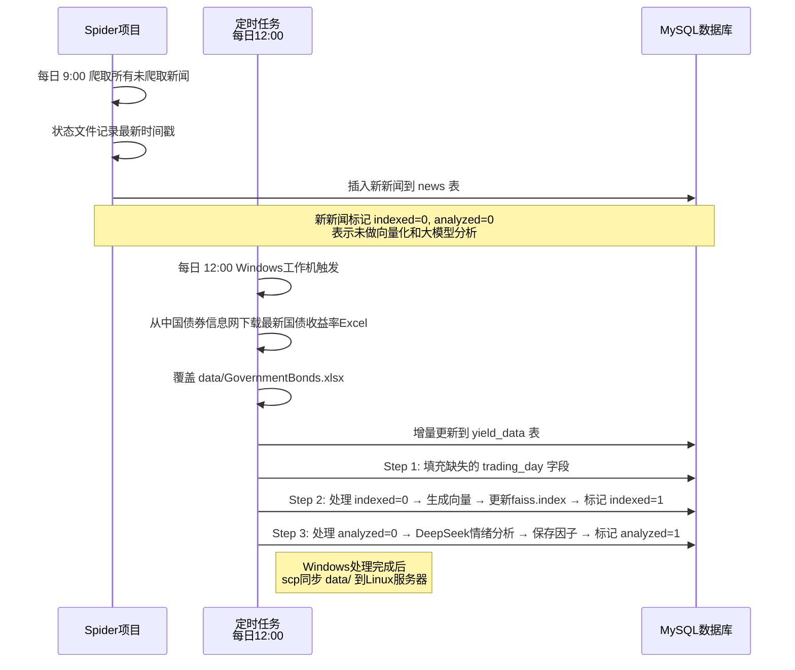

# 4月1号会议

## 市场背景

债券分为4个市场：
- **银行间债券市场**（最主要，占比~87%）
- 交易所市场（次要，占比~12%）
- 银行柜台市场（<1%）
- 自贸区市场（<1%）

两个主要市场是银行间市场和交易所市场，其中银行间市场占绝对主导地位。

## 数据锚定思路

我们目前能够拿到交易所市场的期货价格数据，但这对于不参与交易所交易的客户来说参考价值有限。

因此我们需要将交易所期货价格转换到**全市场通用的定价锚**——即**财政部每日更新的国债收益率曲线**，以此作为全市场的定价基准。

## 完整数据更新链路

整个定时更新链路现已全部打通：

## 处理时序

| 时间 | 步骤 | 执行位置 | 说明 |
|------|------|----------|------|
| 每日 9:00 | 爬取新闻 | Spider项目 | 增量爬取新闻存入数据库 |
| 每日 12:00 | 下载国债收益率 | Windows工作机 | 下载覆盖Excel，增量更新数据库 |
| 每日 12:00 | 填充交易日 | Windows工作机 | 批量填充新闻的 `trading_day` 字段 |
| 每日 12:00 | 新闻向量化 | Windows工作机 | 处理所有 `indexed=0`，更新FAISS索引 |
| 每日 12:00 | 情绪分析 | Windows工作机 | 处理所有 `analyzed=0`，调用大模型分析 |
| 处理完成 | 同步数据 | scp | 将 `data/` 整个目录同步到Linux服务器 |

## 网络环境适配

由于Linux服务器无法联网访问中国债券信息网，采用分离架构：

- **Windows工作机**：可联网，执行完整的下载、向量化、分析流程
- **Linux服务器**：只运行后端和前端，使用Windows同步过来的数据

