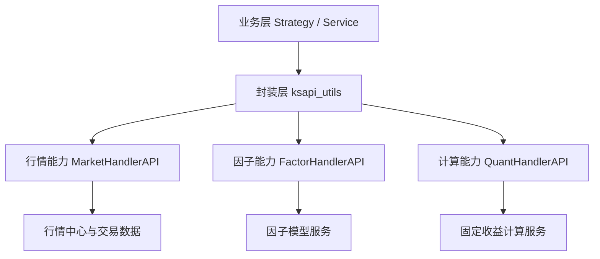

# 农行演示 KSAPI 技术讲解
## 1. 方案定位与价值目标
### 1.1 技术定位

- 统一接入层：通过 ksapi_utils 对底层接口做统一封装，屏蔽多服务差异。
- 统一数据口径：行情、因子、估值结果按统一结构输出，减少跨模块对接成本。
- 统一调用链：策略侧按固定生命周期调用，避免临场拼接接口。

### 1.2 客户价值

- 研发效率提升：从“逐个接口对接”转为“按能力模块调用”，缩短开发周期。
- 运行稳定性提升：关键链路可观测、可追溯，降低生产故障排查成本。
- 管理可复制：接口调用规范化后，策略方案可跨团队快速复用。

---

## 2. 模块分层架构（技术主干）

项目采用三层结构：

1. 业务层：策略逻辑、分析服务、API 服务。
2. 封装层：ksapi_utils 统一入口、参数组织与异常处理。
3. 能力层：MarketHandlerAPI、FactorHandlerAPI、QuantHandlerAPI。

### 2.1 架构图



### 2.2 客户价值映射

- 技术层面统一后，策略团队关注点从“接口细节”转向“交易逻辑本身”。
- 跨服务能力可组合，支持从试点策略平滑扩展到多策略场景。
- 出现数据波动或接口异常时，问题定位边界清晰，保障生产连续性。

---

## 3. KSAPI 能力域概览

### 3.1 行情能力（MarketHandlerAPI）

技术作用：提供查询与订阅两类能力，覆盖债券、IRS、曲线、成交与深度行情。

代表能力：
- 行情查询：load_quotation、market_execution_bond、market_irs_summary
- 行情订阅：subscribe_execution_bond、subscribe_irs_summary
- 基础信息：qry_last_trade_date、qry_bond_irs_basic_info

客户价值：
- 保障策略实时输入稳定，减少交易信号延迟。
- 支持盘中与盘后统一复盘，提升投研与交易协同效率。

### 3.2 因子能力（FactorHandlerAPI）

技术作用：提供标准化因子查询，覆盖国债收益率、IRS 定盘、活跃券与通用因子。

代表能力：
- get_china_debt_ytm
- get_irs_pricing_ytm
- get_actived_bond
- get_normal_factor

客户价值：
- 将“分散数据”转成“可直接用于策略决策”的信号输入。
- 保证同一因子在不同策略中的口径一致，减少执行偏差。

### 3.3 金工计算能力（QuantHandlerAPI）

技术作用：提供收益率、净价、贴现、曲线等固定收益计算能力。

代表能力：
- cal_yield / cal_clean_price / cal_discount_rate
- cal_irs_pricing_valuation
- init_bond_curve / init_irs_swap_curve

客户价值：
- 估值与风控计算标准化，降低人工计算误差。
- 支持策略、风控、估值团队共享同一计算框架。

---

## 4. 策略调用链

### 4.1 技术流程
2. 读取上一交易日核心因子（国债 YTM、IRS 定盘/收盘）。
3. 构建利差信号并确定当日活跃券。
4. 建立当日行情订阅，进入 on_bars 主循环。
5. 按阈值规则进行开平仓判断，并在 on_trade 同步持仓状态。

### 4.2 客户价值

- 决策一致性：同一策略在不同日期、不同环境执行逻辑一致。
- 风险可控性：仓位更新与信号判断形成闭环，减少错单与漏单。
- 可审计性：从因子输入到交易动作链路清晰，便于复盘与归因。

### 4.3 链路示意

```text
on_start
  -> daily_init
  -> 因子读取与利差计算
  -> 活跃券选择与行情订阅
  -> on_bars 信号判断与下单
  -> on_trade 持仓同步
```

---

## 5. 价值总结

- 在既有系统架构下低改造接入，降低试点成本。
- 支持多策略复用同一能力底座，提升组织协同效率。
- 支撑跨团队、跨策略的稳定扩展，形成长期竞争力。


