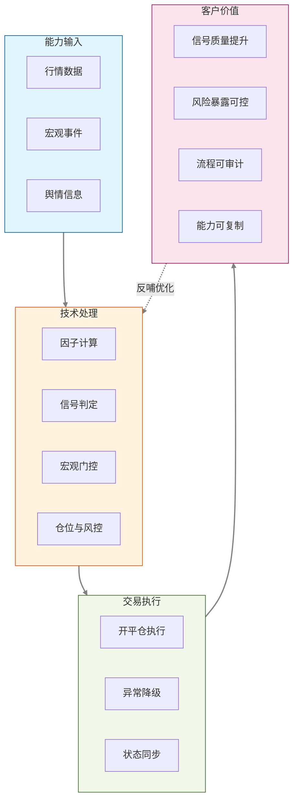

# 农行金工因子能力技术方案

## 1. 金工能力全景与系统边界

### 1.1 能力总览

系统形成了三层闭环：

1. 交易策略层：实现策略的行情订阅与处理、共振识别、突破触发、仓位与风控、执行与诊断。
2. 宏观信号层：将新闻-因子映射为可计算的 presence / directional 信号，用于策略开仓门控。
3. 舆情提取层：使用大模型将新闻结构化为标准字段（direction/horizon/reason/factors），并接入因子库进行复用与增量扩展。

### 1.2 主流程拓扑（逻辑链）

业务问题 -> 因子工程 -> 策略执行 -> 宏观交互 -> 舆情抽取 -> 运维审计

其中关键闭环是：

- 新闻事件 -> 结构化因子 -> 宏观信号 -> 策略门控 -> 交易行为 -> 日志复盘。

---
## 2. 因子开发链路

### 2.1 共性框架

因子能力采用统一开发框架，目标是在保证技术一致性的同时，提升业务可复用性与可解释性。

#### 2.1.1 技术实现

因子计算遵循统一生命周期：

1. 数据接入：从行情库或历史 K 线服务获取数据。
2. 信号计算：按既定规则生成可交易因子值。
3. 标准输出：统一输出数值、方向和状态信息。
4. 异常兜底：在缺数或异常时返回可识别状态，避免中断主流程。

#### 2.1.2 数据来源分层

系统采用两类数据来源以适配不同业务场景：

- 日频筛选类：用于主连与活跃券识别。
- 指标计算类：用于趋势、波动、强弱等技术指标生成。

这种分层设计保证了既能支撑交易标的选择，也能支撑策略信号构建。

#### 2.1.3 标准化与容错

- 统一输出口径：不同因子都可以被策略层直接消费。
- 统一异常表达：缺失数据、质量不足、连接波动都有明确状态反馈。
- 统一扩展方式：新增因子可在不改主流程的前提下接入。

#### 2.1.4 客户价值

- 投研价值：缩短因子从研究到实盘的转化路径。
- 风控价值：异常可识别、可降级，避免因单点问题影响交易连续性。
- 管理价值：统一口径便于绩效归因和跨团队协作。

#### 2.1.5 工程价值

- **统一输出协议**：所有因子通过 FactorResult.value 返回数值，调度层无需感知内部计算逻辑。
- **可重现性**：相同交易日 + 相同参数重复计算可得一致结果。
- **低迁移成本**：核心依赖仅为 MySQL + Python，不绑定特定计算框架。
- **高扩展性**：新增因子只需按模板实现 FactorCompute.main() 并注册即可接入调度流水线。

#### 2.1.7 客户价值映射

- 面向交易：让策略输入标准化，减少执行偏差。
- 面向风控：让异常状态可见化，降低系统性操作风险。
- 面向管理：让能力可复制，支持从试点走向规模化部署。

---

## 3. 策略开发链路

### 3.1 框架结构

#### 3.1.1 策略生命周期函数

所有策略类遵循统一生命周期，核心是把“信号生成、风险约束、交易执行”串成闭环。

**on_init**
- 初始化数据与状态，确保策略起跑条件一致。

**on_start**
- 完成当日准备工作（标的、订阅、日内状态）。

**on_bars** （策略主循环，最关键）
- 在主循环中执行信号判定、门控校验、仓位与开平仓管理。

**on_trade**
- 同步成交与仓位状态，保持策略状态与真实持仓一致。

**on_stop / on_end**
- 输出诊断与汇总信息，为复盘与审计提供依据。

#### 3.1.2 行情订阅与日初始化

策略会在交易日开始前自动完成标的识别、行情订阅和状态初始化，确保进入主循环前的数据口径一致。

客户价值：保证每日开盘前策略状态标准化，减少因初始化不一致导致的执行偏差。

#### 3.1.3 参数治理

策略参数采用集中化管理，便于统一调整回测区间、信号灵敏度、风险预算和门控规则。

客户价值：支持研究、交易、风控按同一参数体系协同工作，减少人工沟通与配置偏差。

#### 3.1.4 工程价值

**统一性与可维护性**
- 所有策略共享同一生命周期约定，降低学习成本与代码审核难度。
- 参数化配置使回测与生产切换无缝，不需修改策略代码。

**因子可解释性与可追溯性**
- 标的选取逻辑透明，便于解释策略为何在当日选择该交易标的。
- 关键切换过程都有日志记录，便于复盘与问题诊断。

**容错与降级**
- 数据异常或外部依赖波动时具备降级能力，保证主流程连续运行。

**可治理性**
- 日志与统计口径统一，便于集中分析和实时告警。

**扩展性**
- 新策略可按统一框架快速接入，支持持续迭代与 A/B 测试。

#### 3.1.5 客户价值映射

- 收益端：策略迭代效率提升，机会响应更快。
- 风险端：关键节点可控、异常可降级，降低运行中断风险。
- 管理端：过程可追溯、结果可复盘，便于制度化运营。

---

# 策略开发与因子价值链路图

## 4. Sentiment 宏观交互能力（API 与策略门控）

### 4.1 信号模型设计

系统支持两类宏观信号：

- presence: 在时间区间内是否出现相关新闻（0/1）。
- directional: 带时间衰减的方向信号（-1/0/1）。

其中 directional 会综合事件方向和时间衰减，对宏观影响进行归一化处理。

客户价值：把宏观信息转化为可执行信号，降低临场主观分歧。

### 4.2 API 暴露与字段

系统通过统一接口对外输出宏观信号，返回因子编码、信号类型、信号值、置信度与时间范围等核心字段，便于外部系统直接接入。

客户价值：通过统一 API 输出实现多系统复用，减少对接成本。

### 4.3 请求日志与可观测性

每次请求都会记录调用时间窗口、请求状态、耗时与错误信息，用于后续审计和运维分析。

工程价值：

- 便于农行侧接入后进行 SLA 审计、失败归因、趋势分析。

客户价值：可量化评估服务稳定性与策略依赖度，支撑生产治理。

### 4.4 策略门控集成与降级

宏观门控能力支持两种模式：

- 研究模式：先观测宏观信号对策略的影响，不直接阻断交易。
- 生产模式：将宏观信号作为真实门控条件，控制高风险时段交易暴露。

当外部接口异常时，系统会按预设规则降级，保证主交易链路不中断。

客户价值：在“研究验证”和“生产控制”之间平滑切换，降低上线风险。

### 4.5 技术关注点

- 与策略耦合方式：软耦合，HTTP 请求即可接入。
- 延迟可控性：支持记录毫秒级请求耗时。
- 风险可控性：失败回退路径明确，不会因外部依赖失败导致策略崩溃。

---

## 5. 舆情因子提取核心（Analyzer）

### 5.1 端到端链路

新闻入库 -> analyze_bond_yield_async -> 大模型输出 JSON -> 解析与兜底 -> 结果落库 -> 因子关联处理。

客户价值：将新闻处理时效从人工流程压缩到策略可用窗口。

### 5.2 提示词约束机制

系统通过预定义因子词表和输出规则约束模型结果，优先复用已有因子，并对新增因子设置统一命名和表达标准。

工程价值：

- 规则外显，可审核。
- 因子词汇统一，降低同义词污染。

客户价值：提升分析结果一致性，减少不同分析人员间口径偏差。

### 5.3 可靠性设计

在稳定性设计上，系统具备重试、解析兜底和异常回退机制，避免模型输出波动直接传导到主业务流程。

客户价值：异常情况下仍可稳定运行，避免分析服务中断影响交易链路。

### 5.4 标准化输出协议

输出结果统一包含方向、影响期限、原因解释和因子列表等核心信息，便于策略系统、报表系统和分析流程直接复用。

客户价值：结构化结果可直接进入策略与报表，减少二次加工成本。

### 5.5 可感知价值

- 信息处理更快：把新闻解读从人工分析压缩为标准化输出。
- 结果口径更一致：减少不同研究人员对同一事件的理解偏差。
- 能力沉淀更强：历史分析结果可持续复用为因子资产。

---
