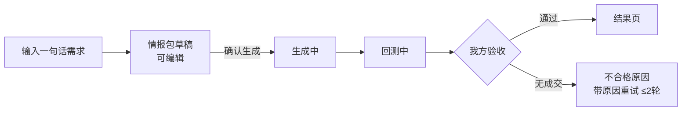
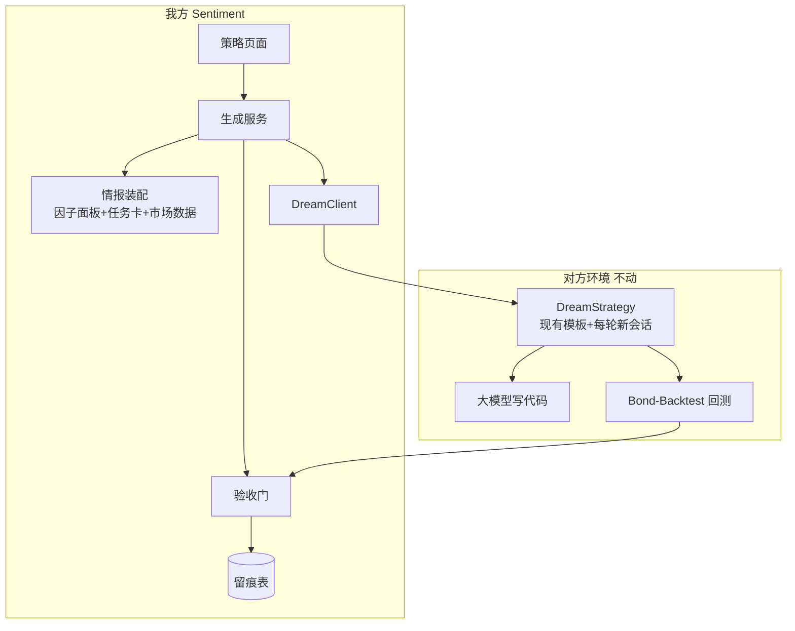
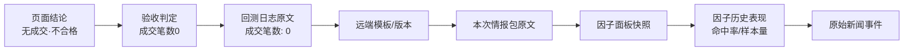

# 舆情因子 × DreamStrategy 策略生成 —— 开发需求文档

## 1. 一句话

用户说一句策略想法，我们把**近期新闻和验证过的因子**整理成情报包，交给 DreamStrategy 写策略代码并回测，**只把有真实成交的结果给用户看**。

分工：**我们出决策，它出代码，我们验收。**

## 2. 现状：链路是通的，但产出没用

| | |
|---|---|
| 能跑通吗 | 能。25 个模板、96 个会话，生成和回测都正常返回 |
| 产出有用吗 | **25 个模板只有 4 个产生过成交**（105 / 234 / 11 / 6 笔），其余 21 个全是 0 成交 |
| "回测通过"可信吗 | **不可信**。平台只要进程正常退出就算通过，0 成交也是 ✓ 通过 |

**为什么 21 个都是 0 成交？两个原因，都要治：**

1. **模型写成了演示稿。** 实测代码注释里写着"以信号日志形式呈现交易指令"——逻辑全对，但每个动作只是 `print`，一次下单接口都没调。
2. **标的让模型自己选。** 曾在债券平台上生成沪金期货策略。实测 4 个有成交的模板，**全部**用的是 `FCT_T_MAIN`。

**为什么因子没起作用？** 现在发给模型的只有 3 个因子中文名。而 381 个因子里，**按 T+5 持有期筛选，样本≥20 且跑赢基准的只有 21 个**（T+1 仅 2 个、T+20 为 17 个，本期固定 T+5）。其余放进去只是噪音。

**我们只能改两个地方**，都在自己这边：**发给它的那段文字** ＋ **我们自己的验收门**。对方提示词加密、模型不可控，改不了。

## 3. 本期范围

| 做（约 4–7 天，全是我方代码） | 不做 |
|---|---|
| 因子信号面板：21 个过关因子里取最多 8 个 | 用满 381 个因子 |
| 任务卡写死标的与交易骨架，明确"必须真实下单，禁止只打日志" | 让模型自己选标的 |
| 验收门：0 成交一律不通过，带原因重试（≤2 轮） | 信对方的"回测通过" |
| 过程可见、数据可溯源（见 §6、§7） | 实盘交易（对方无实盘能力） |
| 错误即时可见 | 重做前端、改对方 C++ 服务 |
| — | **账号级排队**：见下方说明 |
| — | 回测运行期读因子数值（factor 模式）：**需对方给因子编号，没有编号完全不可用**，另行立项 |

> **关于排队：本期不做。** 对端确实是单账号单并发，但触发条件很窄：必须是同一账号在**两个不同会话**里同时点生成。现有代码已有会话级保护（同一会话有任务在跑时直接拒绝，`ai_strategy_history_repository.py:176`），单会话内不会冲突。为这样一个边角场景做队列、位置、等待时长、前端状态，投入产出不划算。
>
> **本期做法**：碰到这种情况，直接返回错误提示，让用户稍后重试，不排队、不显示队列信息。若上线后确实出现并发压力，再单独做。

## 4. 方案

### 4.1 用户流程



用户只点两次：输入需求、确认生成。其余自动流转，页面 4 秒轮询。

### 4.2 系统架构



### 4.3 对端硬约束（我方实现必须适配）

| 约束 | 数值 | 影响 |
|---|---|---|
| 单条消息长度 | ≤ 10,000 token。中文按 **1.5 token/字** 计，即**上限约 6,666 汉字**，超了**直接报错、无截断** | 情报包预算控制在 **≤4000 汉字** |
| 单账号并发 | **同时只能跑一个生成**；回测也是全局单并发 | 第二个并发请求会被对端拒掉。本期靠"拒绝并提示稍后"应对，不做队列（见 §3） |
| 单会话消息数 | ≤ 50 条 | 长对话要定期开新会话 |
| 标的合法性 | **模型侧不做任何校验**，给什么写什么 | 白名单校验必须在我方发送前完成，是唯一防线 |

## 5. 功能需求

| 编号 | 需求 | 验收口径 |
|---|---|---|
| **FR-1** | **因子信号面板**：T+5 口径下 21 个过关因子，按"信号强度×命中率"排序取前 8，带中文名、方向、命中率、基准、样本量、最近触发。窗口回退：近 7 天够 3 个用 7 天 → 不够放宽到 30 天 → 仍不够就有几个写几个并标注"近期无新事件" | 草稿页可见；每个因子可点开看历史表现；无合格因子时显示"证据不足" |
| **FR-2** | **任务卡写死**：标的从 §5.1 白名单选、bar 日频、开平仓骨架、仓位止损，并写明**必须真实下单、禁止只打日志** | 连续生成 5 次，标的 100% 在白名单 |
| **FR-3** | **并发保护**：同账号已有任务在跑时，新请求直接拒绝并提示稍后重试（**不做队列**） | 同会话连点两次，第二个给出明确提示，不会同时发起两个远端生成 |
| **FR-4** | **错误即时可见**：对方报错 30 秒内出结果，不傻等 900 秒超时 | 构造失败场景，30 秒内页面出原因 |
| **FR-5** | **验收门**：三步判定，见 §5.2 | 0 成交显示"无成交（不合格）"，不显示 ✓ 通过 |
| **FR-6** | **全程留痕**：需求原文、因子面板、提示词版本、代码、日志、指标、验收结论 | 任意历史策略能还原当时输入输出 |
| **FR-7** | **过程与数据可见**：四步流程每步可展开查看实际数据，每个结论可溯源到原始依据，见 §6 | 页面任一处结论都能点开看到依据 |

### 5.1 标的白名单

| 标的 | 说明 | 本期定位 |
|---|---|---|
| `FCT_T_MAIN` / `100040` | 10Y 国债期货（别名同一品种） | **默认，唯一实证出过成交的** |
| `FCT_TS_MAIN` | 2Y 国债期货 | 可选，**未经实证** |
| `FCT_TL_MAIN` | 30Y 国债期货 | 可选，**未经实证** |
| `IBK_G10Y_ACTV` / `IBK_CDB10_ACTV` | 银行间 10Y 国债 / 国开活跃券 | 可选，收益率口径同源 |
| ~~`FCT_AU_MAIN`~~ | 上期所**黄金**期货 | **剔除**：因子方向是债市口径，黄金需另行做方向映射，本期不做 |

### 5.2 验收门判定

`成交笔数: N` 这行**只在回测成功的分支才打印**，回测失败时日志里根本没有。所以必须分三步，文案和处置都不同：

```
① 回测是否正常结束（passed / 退出码）
      否 → 判「回测失败」，展示原因，不重试
      是 ↓
② 日志能否解析到「成交笔数: N」
      否 → 判「回测异常」，展示原因，不重试
      是 ↓
③ N > 0 ?
      否 → 判「无成交（不合格）」，带原因重试 ≤2 轮
      是 → 通过
```

另需检查标的与下单类型匹配（期货标的不得用现券下单类型）。

## 6. 过程可见与数据可溯源

这是本期的核心体验诉求：**用户不能只看到一个"通过/不通过"，要能看到走到了哪一步、这一步凭什么得出这个结论。**

### 6.1 四步流程，每步都能展开看实数

页面顶部一条流程条，四个节点各自可点击展开：

| # | 步骤 | 展开后看到 | 数据来源 |
|---|---|---|---|
| 1 | **情报装配** | 本次发给模型的完整情报包原文（任务卡+因子面板+市场块）；实际消耗 token 数 / 4000 预算 | 我方生成时落库的 prompt 快照 |
| 2 | **生成中** | 对端状态文字（生成中 / 检查中） | 对端 `strategy_generation_status` 推送 |
| 3 | **回测中** | 回测日志滚动快照、当前耗时 | 对端 `backtest_log` 增量推送 |
| 4 | **验收** | 三步判定的实际值与阈值（详见 5.2） | 我方验收结果落库 |

> **流程里没有"排队"节点**：本期不做账号级队列（见 §3），对端并发冲突时直接返回错误提示。
>
> **两个降级说明**：① 第 2 步只显示状态文字，**不显示"已重试次数"**——重试是服务端内部行为，用户看到"第 2 次重试中"只会困惑；② 第 3 步是**日志滚动快照**，不是逐行实时流——对端节流为 320ms / 420 字节，页面 4 秒轮询只能取到尾部快照（约最近 28 行），足够看出"在跑、跑到哪了"。

### 6.2 每个结论都要能看到依据

页面上出现的每一个判断，都要能点开看到支撑它的原始数据：

| 页面结论 | 用户点开看到 | 依据来源 |
|---|---|---|
| 因子「货币政策周期」方向 = 多 | 近 7 天触发的事件列表：时间 / 新闻标题 / 方向 / 跳转原文 | `news_factor` + `news` |
| 命中率 0.618（基准 0.606） | 分年度命中率**数字表**（不做走势图）+ 样本量 + 多数类基准，标注"全模型口径" | `factor_event_study` T+5 |
| 标的 `FCT_T_MAIN` 校验通过 | 白名单全文 + 本次比对记录 | 我方校验日志 |
| 成交笔数 0（不合格） | 回测日志中包含该行的上下文原文 | 对端回测日志 |
| 验收：无成交（不合格） | 三步判定逐项结果：①正常结束 ✓ ②解析到成交行 ✓ ③N=0 ✗ | 我方验收结果 |
| 生成的策略代码 | 所属远端版本号 + 对端原始返回（放日志，页面不强调） | `ai_strategy_versions` |

**原则**：不展示无依据的数字。每个数字旁边都要有可点击的溯源入口，做不到就标注"数据不可得"而不是省略。

> **降级说明**：命中率明细本期只给**数字表**，不做分年度走势图（需新写图表组件，且因子详情页已有类似展示可直接跳转）。

### 6.3 溯源链



任意一条结论，用户都能沿着这条链一直点到底。

> **本期只做到前三跳**（结论 → 验收判定 → 回测日志原文）。再往后的「情报包快照 → 因子历史表现 → 原始新闻」直接复用已有页面跳转，不新建链路。

## 7. 页面改造

**只动策略生成页一个页面**（`StrategyPromptPage.tsx`）。路由、导航、会话列表页不动。

### 7.1 布局

```
┌──────────────────────────────────────────────────────────────┐
│ ← 返回策略生成    10Y国债期货双均线策略          [已完成]      │
├──────────────────────────────────────────────────────────────┤
│ 流程条：① 情报装配 ✓ → ② 生成 ✓ → ③ 回测 ✓ → ④ 验收 ✗            │
│         （每个节点可点开看实数）                                │
├──────────────────────────────────────────────────────────────┤
│ 模块：提示词与确认 │ 策略与新闻 │ 回测代码 │ 指标与日志          │
├──────────────────────────────────────────────────────────────┤
│                                                              │
│  【当前模块内容】                                              │
│                                                              │
├──────────────────────────────────────────────────────────────┤
│ AI 生成的研究草案，回测结果不代表实盘                            │
└──────────────────────────────────────────────────────────────┘
```

### 7.2 各模块改动

| 模块 | 现有 | 改动 |
|---|---|---|
| **交易参数表单** | 7 项，无标的 | **加 3 项**：标的下拉（白名单，无黄金）、策略模式、K线周期 |
| **提示词与确认** | 只显示提示词文本 | 加**情报包预览**：任务卡 / 因子面板 / 市场块分段展示；顶部显示 token 用量条（已用/4000） |
| **策略与新闻** | 只有新闻卡片 | **加因子信号面板表**：中文名、方向、信号分、命中率(基准)、样本量、最近触发；每行可点开 §6.2 的详情 |
| **回测代码** | 代码框 + 复制 | 不改 |
| **指标与日志** | 指标平铺 + 日志 | ① 顶部加**验收结论徽章**（通过/无成交/失败）；② **成交笔数置顶**；③ 加**三步判定明细**；④ 保留完整回测日志 |
| **顶部状态** | 只有"生成中" | 四态：生成中 / 回测中 / 重试中 / 已完成 |
| **页面固定标注** | 无 | "AI 生成的研究草案，回测结果不代表实盘" |

### 7.3 接口需新增返回的字段

现有接口结构不变，响应体里补以下字段：

```jsonc
{
  "stage": "validating",           // generating|backtesting|validating|done
  "intel": {
    "prompt_text": "...",          // 情报包原文
    "token_used": 3820, "token_budget": 4000
  },
  "factors": [{
    "code": "MONETARY_POLICY_CYCLE", "name": "货币政策周期",
    "direction": "positive",       // 债市口径，正=收益率下行
    "signal_score": 0.72,
    "hit_rate": 0.618, "majority_base": 0.606,
    "sample_size": 170, "holding_days": 5,
    "latest_event_time": "2026-10-27 14:12",
    "caliber": "all_models",       // 口径标注：全模型
    "evidence_url": "/api/..."     // 溯源入口
  }],
  "validation": {
    "verdict": "no_trade",         // passed|no_trade|backtest_failed|backtest_error
    "steps": [
      { "step": "backtest_finished", "ok": true },
      { "step": "trade_count_parsed", "ok": true, "raw_line": "成交笔数: 0" },
      { "step": "trade_count_positive", "ok": false, "value": 0 }
    ],
    "trade_count": 0,
    "symbol_whitelisted": true
  }
}
```

`verdict` 四值对应 §5.2 的判定结果，前端据此选徽章文案，不自行推断。

## 8. 两个必须讲明白的口径

**① 因子数据有两个来源，不能混。** 近期事件用在线模型 `glm`（但它只有 2026-07 以后的数据）；历史命中率表是全模型混合算的。面板里如实标注"历史表现为全模型口径"，不装精确。

**② 本期回测能证明什么、不能证明什么。** 因子只在生成那一刻影响策略文本，回测的历史时段里策略读不到真实因子值。所以回测通过 = **策略骨架能跑、有成交**；**不等于**证明了因子能赚钱。要验证因子增量效果，得等对方给因子编号后做 factor 模式。

## 9. 验收标准

基线：**25 条策略只有 4 条有成交**。做完后：

1. 同一情报包连续生成 5 条，**至少 4 条有成交**，标的全部在白名单内（未达标须归因：情报质量问题还是平台问题，不把验收线当 KPI 硬凑）；
2. 0 成交显示"无成交（不合格）"，不是 ✓ 通过；
3. 故意发非法需求，30 秒内页面看到明确错误；
4. 同一会话连点两次生成，第二次给出明确提示，不会同时发起两个远端任务；
5. **流程条四个节点都能点开看到实数**；页面任一结论都能溯源到底层数据（§6.2 全部可点通）。

## 10. 要找对方确认的事

按重要性排序，**前 4 条不影响本期开发**（本期全是文字情报链路），只影响后续 factor 模式：

1. **因子编号号段** —— 没有这个，factor 模式完全不可用，"因子真驱动回测"无法验证；
2. 因子推送方式：qfm 推送（推荐，有公布时间字段，天然防未来函数）还是 mock HTTP；
3. 5 年期国债期货 TF 为什么不在可交易品种里；
4. 我们账号的回测平台令牌配了没有（直连测试返回 401）。**另需注意：该令牌只存在对端内存，重启即失效**，对端一重启我们就会全线卡在回测；
5. 为什么部署的是 `xy` 分支而不是 main，是有意还是失误。（已核对：xy 与 main 在我们用到的协议与接口上一致，xy 只多了 factor 逻辑和 mock 分支，不影响本期开发。）

## 11. 红线

- 只改 Sentiment 代码，不动对方服务、不破解 licence、不重启对方进程；
- 凭据不进代码、文档、日志；
- 因子只做方向确认与风险过滤，不单独触发交易；严格按新闻发布时间对齐，防未来函数；
- 对外口径：研究辅助工具，不是自动交易系统。