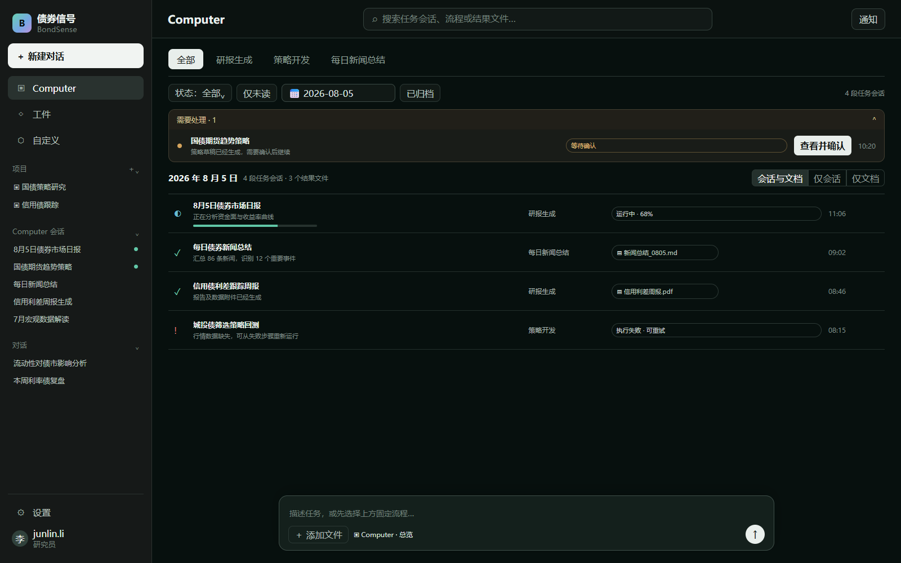
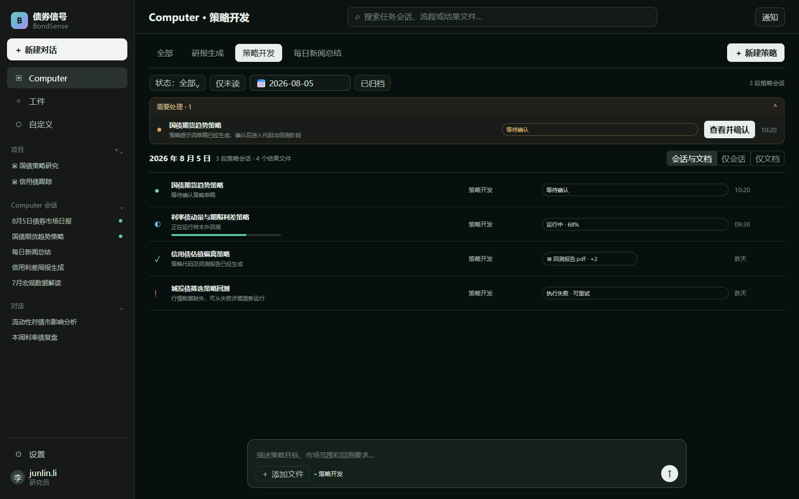
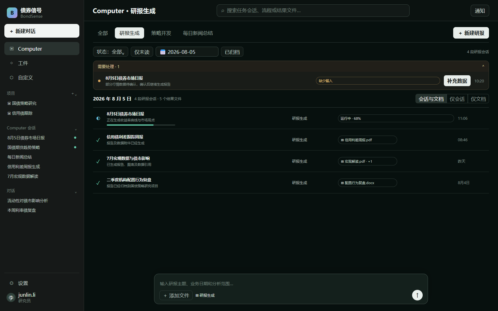

# 02. Computer 模块 PRD

状态：页面结构已确认，固定流程细节待确认

## 1. 模块目标

Computer 是 Sentiment 的固定流程任务中心，用于执行步骤明确、可以自动运行的金融工作。首版提供三类流程：研报生成、策略开发和每日新闻总结。

Computer 不等同于普通 AI 会话。普通会话由用户持续提问；Computer 任务按照预设步骤执行，并具有配置、运行状态、执行记录和最终结果。

## 2. 核心概念

- **流程模板**：系统预先定义的执行流程，例如“生成研报”。
- **任务配置**：用户为某个流程填写的输入内容和执行方式。
- **任务运行**：流程每执行一次产生一条独立运行记录。
- **任务结果**：执行后生成的研报、策略、新闻总结或相关文件。
- **Computer 任务会话**：围绕一次任务运行形成的独立会话，用于补充输入、查看过程、完成确认和接收结果。

首版采用“一次任务运行对应一段 Computer 任务会话”。同一个周期任务可以产生多次运行记录，例如“每日新闻总结”每天执行一次，每天形成一段独立的任务会话和结果，避免所有日期堆积在同一段长会话中。

## 3. 页面结构

Computer 使用一张统一任务中心，不把研报、策略和新闻拆成三个互不关联的页面。“全部、研报生成、策略开发、每日新闻总结”作为同一页面内的分类标签，切换分类时同步切换任务列表和右侧操作。

首版不再单独展示三张“固定流程”功能卡片，避免与分类标签重复。用户先进入具体分类，再创建该类型任务。

### 3.1 任务中心

1. **顶部操作**
   - 显示 Computer 标题和任务搜索。
   - “全部”页面只负责总览、筛选和处理待办，不显示通用“新建任务”。
   - 新建操作放在具体流程分类中，不需要再次弹出流程选择。

2. **流程与筛选**
   - 提供“全部、研报生成、策略开发、每日新闻总结”分类标签。
   - 进入“研报生成”后，右侧显示“新建研报”。
   - 进入“策略开发”后，右侧显示“新建策略”。
   - 进入“每日新闻总结”后，右侧显示“计划管理”和“立即生成”。
   - 支持选择业务日期、任务状态、未读和已归档。
   - 支持按任务会话标题进行搜索。

3. **需要处理**
   - 固定显示等待用户确认、执行失败或缺少输入的任务。
   - 该区域独立于日期列表，避免用户遗漏需要操作的任务。

4. **日期任务会话列表**
   - 列表中的每一行代表一段 Computer 任务会话，而不是单纯的后台日志。
   - 默认按照“今天、昨天、更早”分组。
   - 用户选择具体日期后，只展示该业务日期关联的任务会话和结果文件。
   - 会话行显示标题、流程类型、状态、未读提示和更新时间；结果文件以紧凑附件形式挂在对应会话行上。
   - 当前打开的任务会话保持高亮，已归档会话默认隐藏。

5. **Computer 输入框**
   - 页面底部保留自然语言任务输入框，参考 Perplexity Computer。
   - 系统先判断属于哪一种固定流程，并展示必要配置供用户确认，不直接执行不明确的任务。
   - 用户确认创建后，生成新的任务和对应的 Computer 任务会话。

6. **任务会话详情**
   - 点击会话进入 `/computer/tasks/{taskId}`。
   - 主区域以会话形式展示用户输入、系统追问、执行步骤、确认请求、错误信息和最终结果。
   - 同一任务会话可以进行多轮交互；需要定位较早内容时，可以复用会话模块的轮次导航轨。

### 3.2 按日期组织数据

- 日期筛选使用任务的“业务日期”，而不只使用文件创建时间。
- 例如 8 月 6 日生成的 8 月 5 日市场日报，应归入 8 月 5 日。
- 同一任务的运行记录、任务会话和结果文件通过 `taskId` 关联，默认作为一组展示。
- Computer 首页以任务会话为主记录，文档作为附件挂在对应会话下，不单独混排成第二套长列表。
- 用户需要单独查找时，可以切换“只看任务会话”或“只看文档”。
- 普通 AI 会话不进入 Computer 日期列表，仍由左侧“对话”模块管理。

### 3.3 Computer 任务中心线框图

```text
┌──────────────────┬──────────────────────────────────────────────────────────────┐
│ 全局左侧栏       │ Computer                                               搜索 │
│                  ├──────────────────────────────────────────────────────────────┤
│ + 新建对话       │ 流程： [全部] [研报生成] [策略开发] [每日新闻总结]             │
│                  │ 筛选： [业务日期] [状态] [未读] [已归档]                      │
│ Computer（选中） ├──────────────────────────────────────────────────────────────┤
│ 工件             │ 需要处理                                                     │
│ 自定义           │ ┌──────────────────────────────────────────────────────────┐ │
│                  │ │ ● 国债期货策略开发    等待确认              10:20       │ │
│ 项目             │ └──────────────────────────────────────────────────────────┘ │
│  └ 项目 A        ├──────────────────────────────────────────────────────────────┤
│                  │ 2026 年 8 月 5 日                                            │
│ 对话             │ ┌──────────────────────────────────────────────────────────┐ │
│  └ 普通会话      │ │ ◐ 债券市场日报生成    运行中                09:30       │ │
│                  │ │ ✓ 每日新闻总结        已完成     [新闻总结.md] 09:00    │ │
│ 设置             │ └──────────────────────────────────────────────────────────┘ │
│                  ├──────────────────────────────────────────────────────────────┤
│                  │ ┌──────────────────────────────────────────────────────────┐ │
│                  │ │ 描述一个任务，或选择固定流程……              [开始执行] │ │
│                  │ └──────────────────────────────────────────────────────────┘ │
└──────────────────┴──────────────────────────────────────────────────────────────┘
```

页面说明：

- 全局左侧栏负责切换 Computer、工件、项目和普通会话。
- 主区域顶部负责搜索，分类栏负责切换流程、筛选任务和显示当前分类的操作按钮。
- “全部”不提供新建入口；进入具体分类后，才显示“新建研报”“新建策略”或新闻总结的计划操作。
- “需要处理”始终优先展示等待确认、失败和缺少输入的任务。
- 日期区域展示当天的任务会话，文档作为附件挂在对应会话行上。
- 底部输入框允许用户使用自然语言创建任务，系统识别流程后再让用户确认配置。

### 3.4 已确认页面参考

#### Computer 全部总览

“全部”只负责跨流程总览、日期查询、状态筛选和待办处理。



#### 策略开发分类

进入分类后只展示策略任务，右侧提供“新建策略”。



#### 研报生成分类

进入分类后只展示研报任务，右侧提供“新建研报”。



### 3.5 任务会话详情线框图

```text
┌──────────────────┬──────────────────────────────────────────────────────────────┐
│ 全局左侧栏       │ ← 返回 Computer   国债期货策略开发   等待确认     ···          │
│                  ├──────────────────────────────────────────────────────────────┤
│ Computer（选中） │ 流程进度                                                     │
│                  │ [需求确认 ✓] ─ [生成草稿 ✓] ─ [用户确认] ─ [策略与回测]       │
│                  ├──────────────────────────────────────────────────────────────┤
│                  │ 用户：开发一个国债期货趋势策略                               │
│                  │                                                              │
│                  │ Computer：已生成策略提示词草稿，请确认或修改。                │
│                  │ ┌──────────────────────────────────────────────────────────┐ │
│                  │ │ 可编辑的策略提示词草稿                                  │ │
│                  │ │                                         [修改] [确认]   │ │
│                  │ └──────────────────────────────────────────────────────────┘ │
│                  │                                                              │
│                  │ 执行完成后：策略说明、代码、回测指标、结果文件                │
│                  ├──────────────────────────────────────────────────────────────┤
│                  │ [添加文件]  补充任务要求……                        [发送]      │
└──────────────────┴──────────────────────────────────────────────────────────────┘
```

任务会话详情说明：

- 顶部显示任务标题、流程类型、状态和关键操作。
- 流程进度用于展示当前执行到哪一步。
- 中间区域使用会话形式承载补充输入、系统追问、确认请求和执行结果。
- 生成的研报、策略代码和新闻总结直接挂在对应结果消息下。
- 用户离开详情页后任务继续执行，返回时恢复原来的会话和进度。

## 4. 固定流程

### 4.1 研报生成

**实现功能**

- 用户选择报告日期或分析范围，并填写必要的研报主题。
- 系统调用现有新闻分析、市场数据和报告生成能力，生成研报内容。
- 任务完成后支持在线查看和下载结果。

**交互逻辑**

1. 用户先进入“研报生成”分类。
2. 用户点击右侧“新建研报”，打开简单配置表单，填写主题、日期或分析范围。
3. 用户点击“开始生成”，系统创建一条任务记录。
4. 页面进入任务详情，并依次显示“准备数据—分析—生成报告—完成”。
5. 任务完成后显示研报摘要和“查看报告”“下载文件”。
6. 任务失败时显示失败步骤、原因和“重新运行”。

### 4.2 策略开发

**实现功能**

- 用户输入策略需求和必要的市场范围。
- 系统根据现有流程生成策略提示词草稿。
- 用户确认或修改草稿后，系统生成策略、代码和回测结果。

**交互逻辑**

1. 用户先进入“策略开发”分类。
2. 用户点击右侧“新建策略”，填写策略需求、回看天数等必要参数。
3. 系统创建任务并生成可编辑的策略提示词草稿。
4. 任务状态变为“等待确认”，用户可以修改草稿。
5. 用户点击“确认生成”后，系统继续生成策略和回测结果。
6. 完成后显示策略说明、代码、回测摘要和关键指标。
7. 未经用户确认时，不进入正式策略生成阶段。
8. 失败时保留已经确认的输入，并允许从失败步骤重新运行。

### 4.3 每日新闻总结

**实现功能**

- 用户设置关注范围、生成时间和是否启用。
- 系统每天按设定时间汇总新闻并生成总结。
- 用户也可以手动执行一次，用于预览当天结果。

**交互逻辑**

1. 用户先进入“每日新闻总结”分类。
2. 用户点击“计划管理”设置周期任务，或者点击“立即生成”执行一次。
3. 创建周期计划时，用户选择关注范围和每日执行时间。
4. 用户点击“保存并启用”后生成一条周期任务配置。
5. 到达执行时间后，系统自动创建当天的任务运行记录。
6. 任务完成后显示日期、新闻数量、核心事件和市场影响总结。
7. 用户可以暂停或重新启用该周期任务。
8. 点击“立即生成”会新增一次手动运行，不影响原定时计划。
9. 某一天执行失败时保留失败记录，并允许单独重试当天任务。

## 5. 任务状态与交互

首版统一使用以下状态：

- **等待执行**：任务已经创建但尚未开始。
- **运行中**：系统正在执行。
- **等待确认**：策略草稿已经生成，等待用户确认。
- **已完成**：任务成功结束并产生结果。
- **失败**：执行未完成，可以查看原因并重试。

交互规则：

1. 用户先进入具体流程分类，再通过分类右侧的新建按钮创建对应任务；也可以通过底部输入框描述任务。
2. 从底部输入框创建时，系统先识别流程并让用户确认必要配置。
3. 创建成功后进入对应任务会话；用户离开页面不会停止后台任务。
4. 返回 Computer 页面后，可以从日期任务会话列表继续查看进度。
5. 等待确认、失败或缺少输入的任务会话进入“需要处理”区域。
6. 点击会话行打开任务会话；点击行上的文件附件直接查看结果。
7. 新消息、确认请求或任务完成后产生未读提示，打开会话后标记为已读。
8. 用户可以归档已完成的任务会话；归档不会删除任务或文件。
9. 运行中的任务在左侧 Computer 入口或任务会话列表显示状态提示。
10. 同一任务重复点击提交时只创建一次有效运行。
11. 重试产生新的运行记录，并保留原失败记录。
12. 用户只能查看和操作自己有权限访问的任务会话。

## 6. Computer 与其他模块的关系

- **会话**：Computer 任务会话由 Computer 页面单独整理，支持日期、流程、状态、未读、归档和标题搜索；它不会混入左侧普通“对话”列表。
- **项目**：后续可以将任务归入某个项目，并继承项目的数据和成员权限。
- **工件**：首版先在任务详情中查看和下载结果；工件模块完成后，再将研报、策略和新闻总结同步进入工件列表。
- **自定义**：Computer 首版只提供固定流程；用户自行编排流程由后续“自定义”模块负责。

## 7. P0 实现顺序

1. 建立任务、任务运行、业务日期、任务会话和结果文件的关联结构。
2. 完成统一任务中心、“需要处理”和按日期分组列表。
3. 完成四个分类标签、分类内新建操作、自然语言输入和配置确认。
4. 接入研报生成固定流程。
5. 接入策略开发及用户确认流程。
6. 接入每日新闻总结和基础定时配置。
7. 完成任务详情、失败重试和结果查看。
8. 增加日期、流程类型、状态和内容类型筛选。

## 8. P0 验收标准

- 点击左侧 Computer 可以进入独立任务中心。
- 页面提供研报生成、策略开发和每日新闻总结三个固定流程。
- “全部”页面不重复展示固定流程卡片，也不提供通用新建入口。
- 进入研报、策略或新闻总结分类后，页面显示对应的新建或计划管理操作。
- 用户可以手动创建任务；每次任务运行都会生成一段独立的 Computer 任务会话。
- Computer 任务会话支持按日期、流程、状态、未读和归档整理。
- 点击任务会话可以继续补充输入、完成确认并查看执行结果。
- 策略开发必须经过用户确认后才能正式生成策略。
- 每日新闻总结可以设置执行时间、暂停、启用和立即运行。
- 用户离开任务页面后，任务可以继续在后台执行。
- 任务中心按照“需要处理、今天、昨天、更早”组织记录。
- 用户可以选择业务日期，查询当天的任务会话和结果文档。
- 同一任务的会话和文档关联展示，不在主列表中杂乱混排。
- 用户可以按流程类型、状态和内容类型进一步筛选。
- 任务失败后能够查看原因并重新运行。
- 任务运行和任务会话不会混入普通会话历史。

## 9. P0 暂不实现

- 用户自由拖拽和编排流程节点。
- 自定义代码节点和第三方工具节点。
- 复杂的分钟级、工作日和节假日调度规则。
- 多人审批和项目成员权限。
- 多渠道自动推送。
- 跨任务依赖和任务编排。
- 任务结果自动进入工件库，待工件模块确定后接入。

## 10. 待继续确认

- 研报生成需要用户填写哪些必要输入，以及最终报告格式。
- 策略开发首版支持哪些策略类型和市场范围。
- 每日新闻总结的关注范围、默认执行时间和结果展示结构。
- 首版是否需要将结果发送到飞书、企业微信、钉钉或邮箱。


