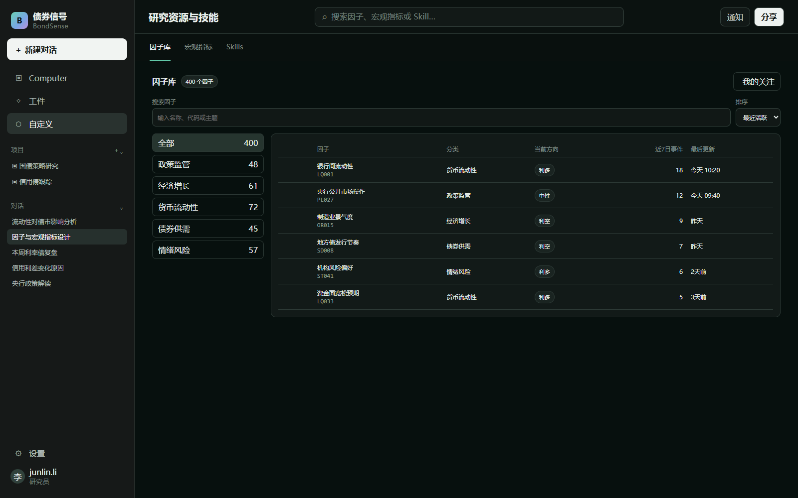
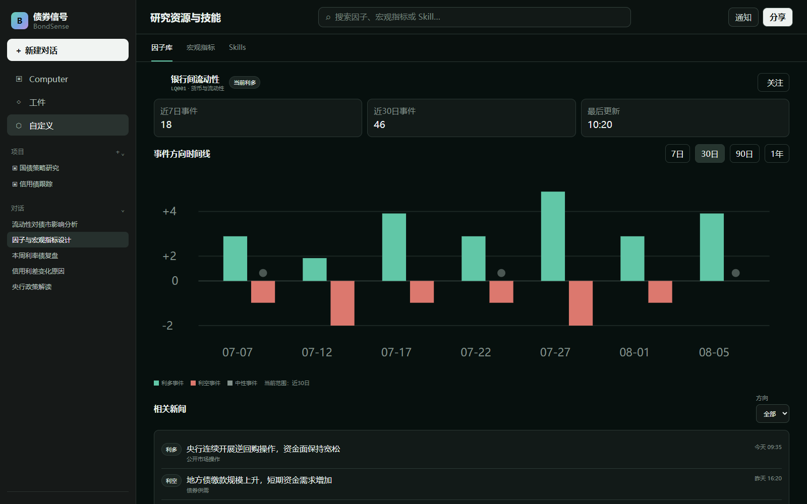
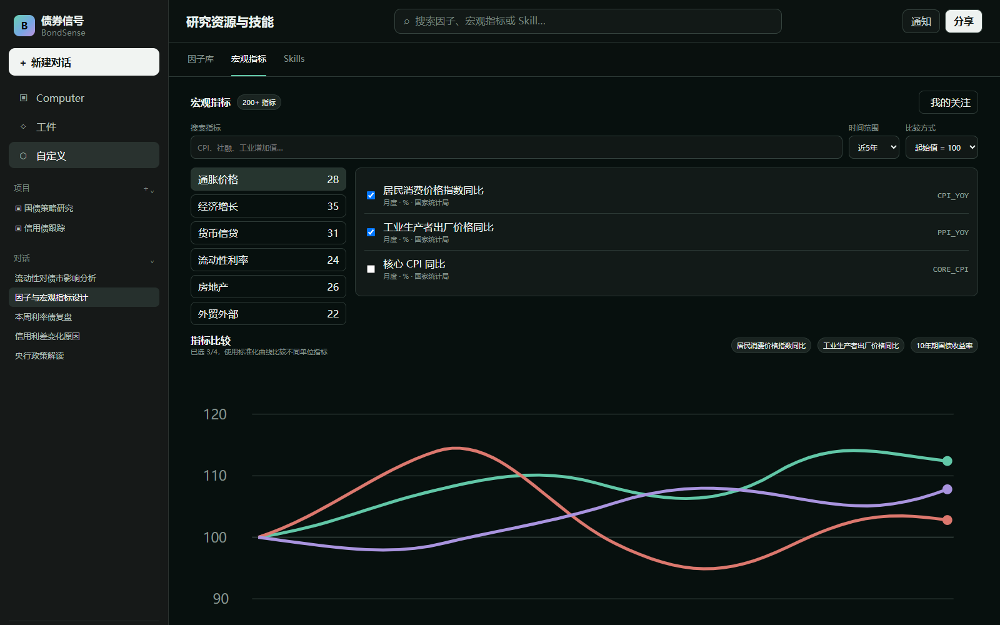

# 03. 自定义模块 PRD

状态：因子库和宏观指标页面结构已确认，Skill 细节待确认

## 1. 模块目标

自定义模块用于集中查看和管理研究资源，首版包含三个分类：因子库、宏观指标和 Skills。

- 因子库：帮助用户从约 400 个因子中快速筛选、理解和使用目标因子。
- 宏观指标：帮助用户从约 200 个指标中按主题查找、查看走势并进行少量指标比较。
- Skills：查看和管理系统提供或用户创建的研究技能。

三个分类共用全局左侧栏和顶部搜索，不拆成三个独立产品。

## 2. 页面结构

进入“自定义”后，主区域顶部提供：

```text
[因子库] [宏观指标] [Skills]
```

- 切换分类时只替换主内容区，全局左侧栏保持不变。
- 搜索范围跟随当前分类变化。
- 从列表进入详情后，返回时保留原来的分类、筛选条件和列表位置。

## 3. 因子库

### 3.1 因子列表

因子数量约 400 个，首版不使用大卡片逐个展示，采用“分类导航 + 搜索 + 紧凑表格”。

**实现功能**

- 按业务主题建立分类，例如政策监管、经济增长、货币流动性、债券供需和情绪风险。
- 支持按因子名称、代码和关键词搜索。
- 支持“我的关注”，用户可以收藏常用因子。
- 支持按最近活跃、新闻数量和最近更新排序。
- 列表显示因子名称、代码、分类、当前方向、近期事件数量和最后更新时间。

**交互逻辑**

1. 默认展示全部因子，并优先显示最近活跃的因子。
2. 用户选择左侧分类后，只显示该分类中的因子。
3. 搜索和分类条件可以同时生效。
4. 点击因子进入单因子详情页。
5. 返回列表时恢复原筛选条件和滚动位置。

### 3.2 单因子详情

单个因子使用一张详情页，不再拆成三个页面。

**页面内容**

1. 紧凑概览：因子名称、代码、分类、当前方向、更新时间和简要解释。
2. 核心趋势：展示因子在所选时间范围内的方向和强度变化。
3. 事件时间线：X 轴为时间，Y 轴表示事件数量和正负方向。
4. 相关新闻：展示影响该因子的新闻标题、摘要、时间和方向。

**时间线与新闻联动**

- 时间线和相关新闻放在同一页面，并建立联动关系。
- 点击时间线上的某个日期或事件点，新闻列表只展示对应时间附近的新闻。
- 点击新闻后，在时间线上高亮对应事件点。
- 如果首版数据暂时不能完成双向联动，允许先上下排列展示，但必须保留统一时间筛选。

## 4. 宏观指标

### 4.1 指标分类与列表

宏观指标数量超过 200 个，首版使用业务分类，不要求用户逐个浏览。

**一级分类建议**

- 经济增长
- 通货膨胀
- 就业与收入
- 货币与流动性
- 财政与政府融资
- 房地产
- 外贸与国际收支
- 市场与金融条件

**辅助筛选**

- 数据频率：日、周、月、季、年。
- 数据来源。
- 最近更新时间。
- 我的关注。

列表显示指标名称、分类、最新值、频率、最新发布日期和近期变化方向。

### 4.2 单指标详情

**实现功能**

- 展示指标定义、单位、频率、来源、最新值和发布时间。
- 使用时间序列图展示历史走势。
- 提供 1 个月、3 个月、6 个月、1 年、3 年、全部和自定义时间范围。
- 在图表下方展示相关数据发布时间、政策事件或相关新闻。

默认进入单指标模式，减少页面复杂度。

### 4.3 多指标比较

- 用户主动进入“比较模式”后才可以多选指标。
- 首版最多同时比较 4 个指标。
- 同单位指标可以直接比较原始值。
- 不同单位指标默认使用标准化或基期指数进行比较，并明确显示转换方式。
- 比较结果使用同一时间轴，支持统一修改时间范围。
- 首版不支持大量指标同时叠加，避免图表失去可读性。

## 5. Skills

Skills 用于管理可以被对话、Computer 或项目调用的研究能力。

### 5.1 P0 功能

- 展示系统 Skill 和用户自定义 Skill。
- 支持按名称和用途搜索。
- 展示 Skill 名称、说明、输入要求、输出内容、状态和最后更新时间。
- 支持启用、停用和查看详情。
- 支持创建简单 Skill，填写名称、用途说明、执行指令和输出格式。
- 支持编辑或删除用户自己创建的 Skill；系统 Skill 只能查看和启用。

### 5.2 使用方式

- 在普通会话中选择或由系统推荐 Skill。
- 在 Computer 固定流程中调用已启用的 Skill。
- 后续可以在项目设置中指定项目默认使用的 Skill。

### 5.3 P0 暂不实现

- 可视化拖拽工作流。
- 第三方 Skill 市场。
- Skill 版本发布和复杂回滚。
- 多人协作编辑和审批。
- 自定义代码运行环境。

## 6. 页面参考

### 6.1 因子库全局页面



### 6.2 单因子详情页面



### 6.3 宏观指标页面



## 7. P0 实现顺序

1. 完成自定义模块全局页面及三个分类标签。
2. 建立因子分类、搜索、关注和紧凑列表。
3. 完成单因子详情、趋势图、事件时间线和相关新闻。
4. 建立宏观指标分类、搜索和单指标详情。
5. 完成宏观指标时间范围选择。
6. 增加最多 4 个指标的比较模式。
7. 完成 Skill 列表、详情、启用和停用。
8. 完成简单自定义 Skill 的创建与编辑。

## 8. P0 验收标准

- 用户能够通过分类和搜索从约 400 个因子中快速找到目标因子。
- 因子列表不需要逐个打开即可看到方向、活跃度和更新时间。
- 单因子详情在一张页面中展示概览、趋势、事件时间线和相关新闻。
- 用户能够通过业务分类和搜索查找 200 多个宏观指标。
- 单指标支持常用时间范围和自定义时间范围。
- 比较模式最多选择 4 个指标，不同单位时明确显示标准化方式。
- 用户能够查看、搜索、启用和停用 Skill。
- 用户能够创建和编辑基础自定义 Skill。

## 9. 待继续确认

- 因子的最终分类标准和现有 400 个因子的分类映射。
- 因子“当前方向”和“事件强度”的计算方式。
- 宏观指标的最终分类、数据源和更新频率。
- 不同单位宏观指标默认采用哪一种标准化方式。
- 自定义 Skill 首版允许用户配置到什么程度。
